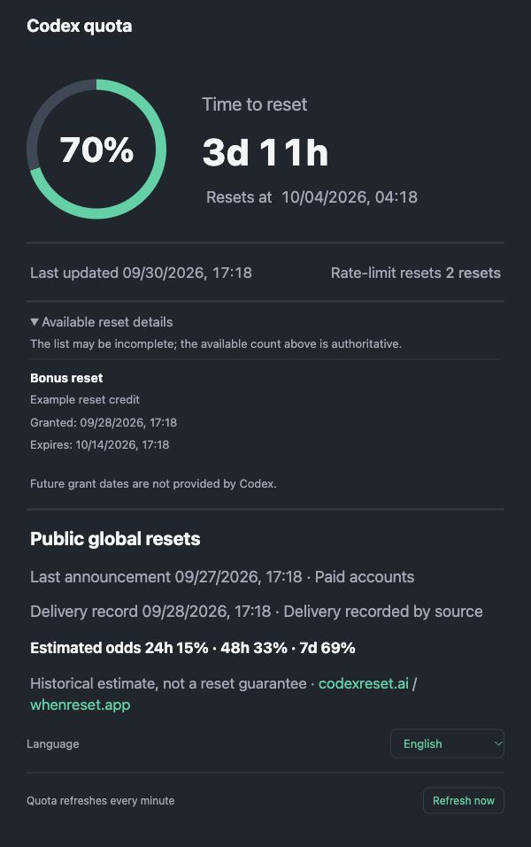

# Codex Quota Widget

English | [简体中文](README.zh-CN.md)

A small Windows and macOS desktop widget for Codex quota. See remaining weekly quota, reset time and countdown, the last successful update, and available rate-limit reset credits. Plus accounts also show the five-hour window when provided by Codex.

This is an independent, unofficial tool, with no OpenAI affiliation or endorsement.

Illustrative browser detail page with fabricated sample data:

## Install

Version **0.1.0** packages include Node.js **24.19.0** and its license. You do not need to install Node or developer tools to use a prebuilt package.

| Platform | Package | Installation guide |
| --- | --- | --- |
| macOS 13.5+, Apple Silicon | `CodexQuotaWidget-0.1.0-macos-arm64.zip` | [macOS](macos/README.md) |
| macOS 13.5+, Intel | `CodexQuotaWidget-0.1.0-macos-x64.zip` | [macOS](macos/README.md) |
| Windows x64 | `CodexQuotaWidget-0.1.0-windows-x64.exe` | [Windows](windows/README.md) |

Use the package and `SHA256SUMS` supplied for the same build. Private build artifacts are available to repository collaborators under **Actions → Build packages → a successful run → Artifacts**. The workflow does not publish a GitHub release.

Install the official [Codex desktop app](https://learn.chatgpt.com/docs/app) or [Codex CLI](https://learn.chatgpt.com/docs/codex/cli), then sign in with the ChatGPT account to monitor. The widget needs a discoverable Codex CLI/App Server. If your desktop installation is not detected, install the official CLI and run `codex login`. No Codex executable or login credentials are redistributed.

The macOS app is ad hoc signed, without Developer ID signing or Apple notarization. The Windows installer is unsigned. Your operating system may show a security prompt; verify the source and checksum before approving it.

To run from source, install Node.js 24+ and follow the platform guide. macOS source builds also need Apple Command Line Tools. Only run one copy per computer: the service uses `127.0.0.1:39224`.

## Use

- Switch between a compact percentage ring and detailed view; drag to move or resize. Each mode remembers its position and size.
- Use the Windows tray menu or macOS menu bar to show the window, refresh, change language, or quit. The macOS Dock icon also shows remaining weekly quota.
- Choose **Language → System / English / 简体中文**. System selects Chinese for a Chinese system language and English otherwise. The browser detail page and native UI share the saved choice.
- Open **Reset details** to see the authoritative available count and any grant or expiry dates Codex provides. Missing dates are shown as unavailable. The widget never spends a reset credit or predicts future grants. Reset credits are separate from paid usage credits and the normal reset countdown.

Quota queries and cache checks run every **60 seconds**. Manual refresh, reopening, and waking the computer refresh promptly; simultaneous requests are combined. Temporary query failures retry after **15, 30, then 60 seconds**. Unavailable, expired, or stale quota is shown as `—`, rather than continuing to present an old percentage as current.

Public reset announcements and historical odds from [codexreset.ai](https://codexreset.ai/) and [whenreset.app](https://whenreset.app/) refresh separately every **10 minutes**. Historical odds do not promise a future reset time.

## Privacy and troubleshooting

The local service uses the read-only `account/read` and `account/rateLimits/read` methods of [Codex App Server](https://learn.chatgpt.com/docs/app-server). It listens only on loopback. No OpenAI API key is required. Account quota and login information are not sent to the public reset sites; settings and logs stay on your computer.

If quota is unavailable, follow the displayed instruction, check `codex login status`, and choose **Refresh**. The platform guides list log locations and restart/uninstall steps. Do not share credentials, raw account responses, unredacted logs, or personal account screenshots in bug reports.

App Server can change with Codex updates. Hosted-runner tests use fabricated data; they do not prove real-account login or physical Intel Mac/Windows desktop compatibility. The Windows installer offers startup at login as an optional unchecked task. Notifications and remote sync are not included.

## Development and license

See [CONTRIBUTING.md](CONTRIBUTING.md) for tests and builds, and [CHANGELOG.md](CHANGELOG.md) for version notes.

[MIT](LICENSE), copyright 2026 AjiaGit, applies to project code and documentation. Bundled dependencies and external services retain their own terms; see [THIRD_PARTY_NOTICES.md](THIRD_PARTY_NOTICES.md).
