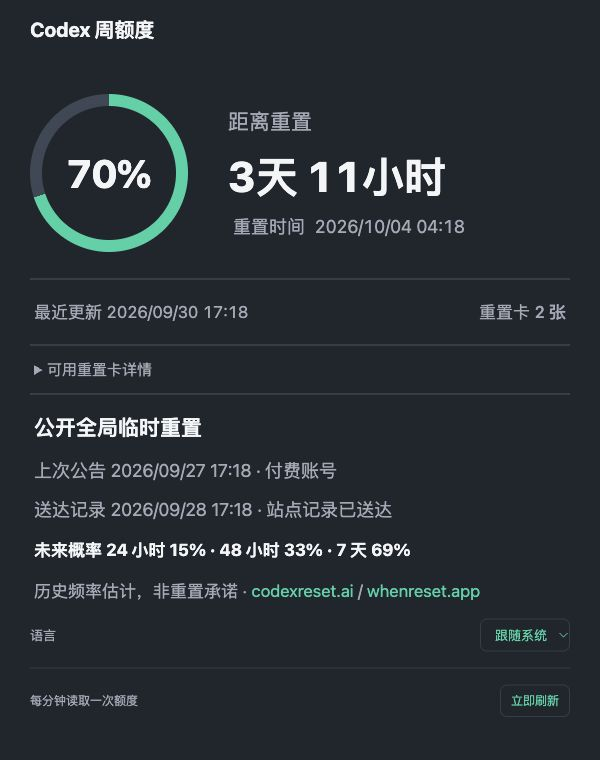

# Codex 周额度悬浮窗

[English](README.md) | 简体中文

在 Windows 和 macOS 桌面查看 Codex 额度的小工具：显示本周剩余、重置时间与倒计时、最近成功更新时间、可用重置卡数量；Plus 账号在 Codex 提供数据时另显示 5 小时额度。

这是独立的非官方工具，与 OpenAI 无关联，也未获其背书。

浏览器详细页示例，以下为虚构演示数据：

## 安装

**0.1.0** 安装包内置 Node.js **24.19.0** 及其许可证。使用预编译安装包无需另装 Node 或开发工具。

| 系统 | 文件 | 安装步骤 |
| --- | --- | --- |
| macOS 13.5+，Apple Silicon | `CodexQuotaWidget-0.1.0-macos-arm64.zip` | [macOS](macos/README.zh-CN.md) |
| macOS 13.5+，Intel | `CodexQuotaWidget-0.1.0-macos-x64.zip` | [macOS](macos/README.zh-CN.md) |
| Windows x64 | `CodexQuotaWidget-0.1.0-windows-x64.exe` | [Windows](windows/README.zh-CN.md) |

请使用同一次构建提供的安装包与 `SHA256SUMS`。仓库协作者可在 **Actions → Build packages → 成功的运行 → Artifacts** 下载私有构建产物；工作流不会发布 GitHub Release。

先安装官方 [Codex 桌面应用](https://learn.chatgpt.com/docs/app)或 [Codex CLI](https://learn.chatgpt.com/docs/codex/cli)，并用要监控的 ChatGPT 账号登录。工具需要找到 Codex CLI／App Server；若未识别桌面安装，请按官方说明安装 CLI 后运行 `codex login`。安装包不包含 Codex 程序或任何登录凭据。

macOS 应用仅有临时签名，没有 Developer ID 签名或 Apple 公证；Windows 安装程序未签名。系统可能显示安全提示，请核对来源和校验值后再决定打开。

从源码启动需安装 Node.js 24+；macOS 还需 Apple 命令行工具，详见系统指南。同一台电脑只运行一份：本机服务使用 `127.0.0.1:39224`。

## 使用

- 在极简百分比圆环与详细窗之间切换，拖动移动或缩放；两种模式各自记住位置和尺寸。
- 从 Windows 托盘或 macOS 菜单栏显示窗口、刷新、切换语言或退出；macOS 程序坞图标也显示本周剩余。
- 在**语言 → 跟随系统 / English / 简体中文**中选择。跟随系统在中文系统语言下显示中文，其余显示英文。浏览器详细页与原生界面共用已保存的选择。
- 打开**重置详情**查看可用数量，以及 Codex 提供的发放／到期时间。未提供的日期会明确说明；工具不会使用重置卡，也不推测未来发放。重置卡与付费使用额度、固定额度重置倒计时分别显示。

账号额度查询和缓存检查均每 **60 秒**进行。手动刷新、重新打开和电脑唤醒后及时刷新，同时发起的请求会合并。临时查询失败后按 **15、30、60 秒**重试。不可用、已到重置时间或过旧的额度显示为 `—`，旧百分比不会继续当作当前数据。

[codexreset.ai](https://codexreset.ai/) 和 [whenreset.app](https://whenreset.app/) 的公开重置记录及历史概率单独每 **10 分钟**更新。历史概率不代表未来必然重置，也不是时间承诺。

## 隐私与故障排查

本机服务通过 [Codex App Server](https://learn.chatgpt.com/docs/app-server) 的只读 `account/read` 和 `account/rateLimits/read` 获取数据，只监听本机回环地址，无需 OpenAI API Key。不会向公开重置站点发送个人额度或登录信息；设置与日志留在本机。

若显示不可用，请按界面提示处理，检查 `codex login status` 后点击**刷新**。系统指南列出日志位置、重新启动及卸载步骤。反馈问题时不要上传凭据、原始账号响应、未脱敏日志或个人账号截图。

Codex 更新可能改变 App Server。托管运行环境测试使用虚构数据，不代表已验证真实账号登录或实体 Intel Mac／Windows 桌面兼容性。Windows 安装程序提供可选的登录时启动，默认不勾选。本版没有主动通知或远程同步。

## 开发与许可证

开发和构建说明见 [CONTRIBUTING.md](CONTRIBUTING.md)，版本说明见 [CHANGELOG.md](CHANGELOG.md)。

项目代码和文档采用 [MIT](LICENSE)，版权归 2026 AjiaGit。内置依赖和外部服务遵循各自条款，见 [THIRD_PARTY_NOTICES.md](THIRD_PARTY_NOTICES.md)。
